# 简介

NanoPi NEO是属于NanoPi产品线最平民的一块板，功能简单实用：RJ45、USB2.0、UART、GPIO以及SPI、I2C这类工业控制接口一应俱全，硬件规格比较低端，但是对于开发板来说足够用。

NanoPi NEO使用的CPU是全志H3，这是全志官方给出的配置信息：

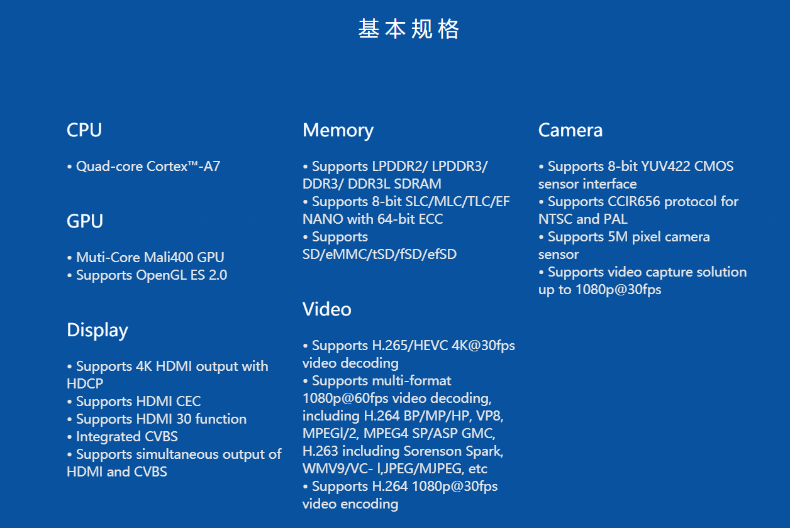

显然，这款芯片最大的亮点就是它的GPU和它的视频编解码能力了，那么是不是NanoPi NEO就可以拿来做电视盒子了呢？

很遗憾，虽然NanoPi NEO用了这款芯片，但是板子并没有提供任何视频输入、输出接口，而且官方提供的操作系统FriendlyCore和OpenWRT都特地将X-Window移除了，虽然说是“提高性能”，但是摆明了就是不给用视频输出。

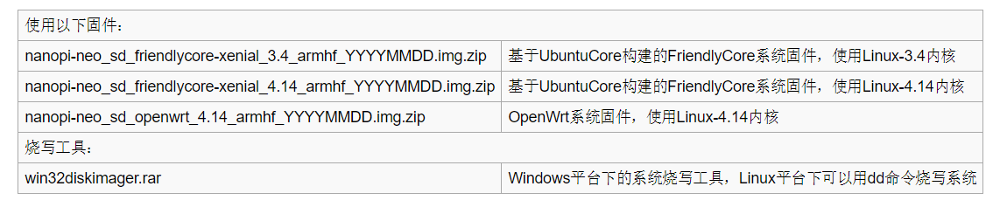

其实这也就反映了NanoPi NEO的定位：一个嵌入式的全功能系统。毕竟全志H3用的是六年前的ARM Cortex-A7架构，它的性能再强也强不到哪里去，其实已经无法应付现在的图形处理需求了，这样的话不如直接不要图形输入、输出，还能剩一些空间。毕竟，塞的东西太多的唯一结果就是塞不下。这款板子最突出的特点就是“小”：官方指出它只有40 mm x 40 mm大，比大多数Arduino板还要小，能力却强大很多。

# 上手

这次我从同学那里嫖来一台NanoPi NEO 512M版，版本不是官网维基上最新的那个了，接口位置有些不同，但是配置是一样的。

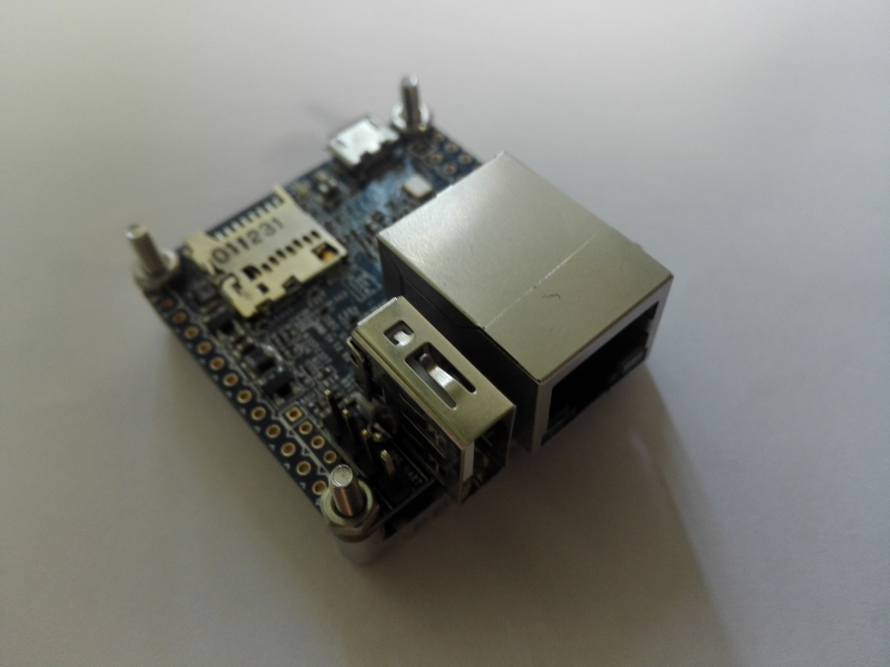

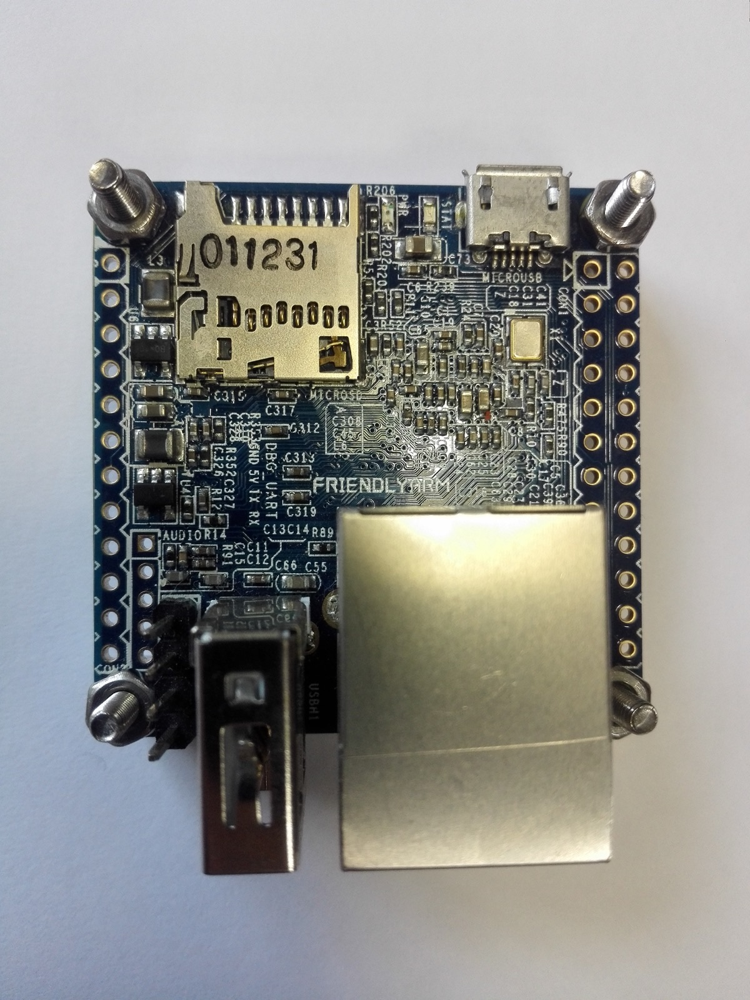

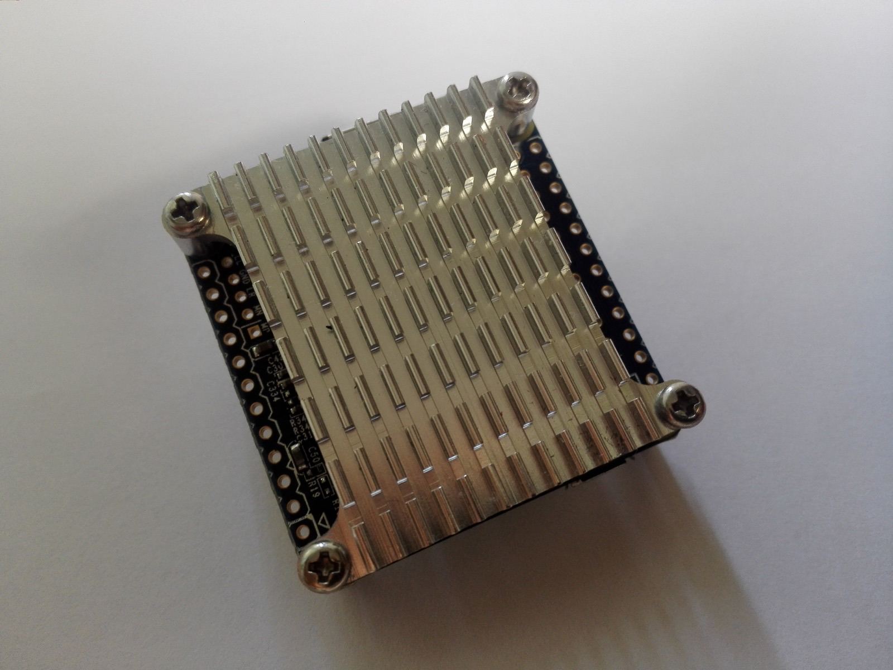

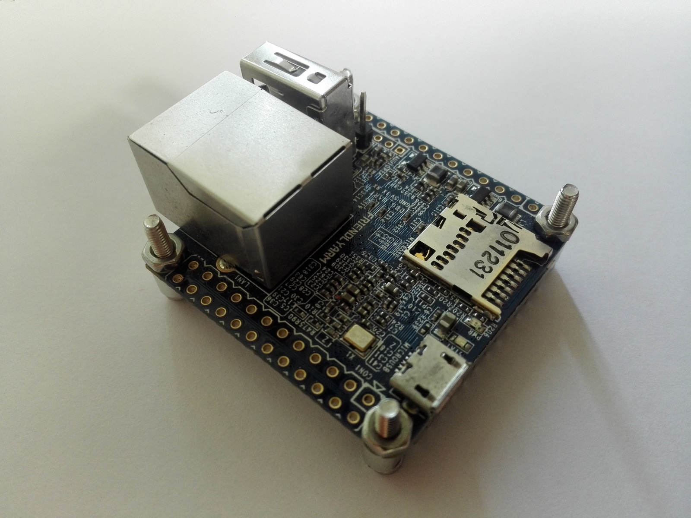

官网上面说SanDisk Ultra是经过认证的SD卡，刚好有一块，那就用上它吧。

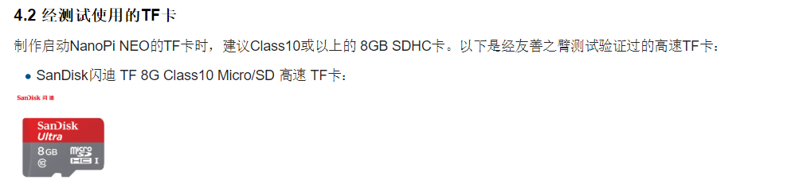

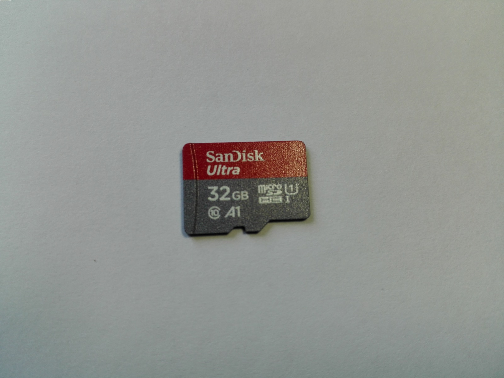

不过这次有点遗憾的就是我的USB转TTL模块丢了，就只能用网络SSH来调试，希望FriendlyCore默认网络配置正确。

首先在官网下载固件FriendlyCore，注意要解压出里面的.img文件：

然后还要下载Win32DiskImager来写入。据说Rufus和UltraISO也可以用，以后再试试。

注意这里比较坑的一点就是官网没有写到要格式化SD卡，但是Win32DiskImager写入没有格式化的SD卡时可能会把空间识别小了，这样就会有一部分空间浪费掉，所以建议大家用 *SDFormatter* 进行格式化。

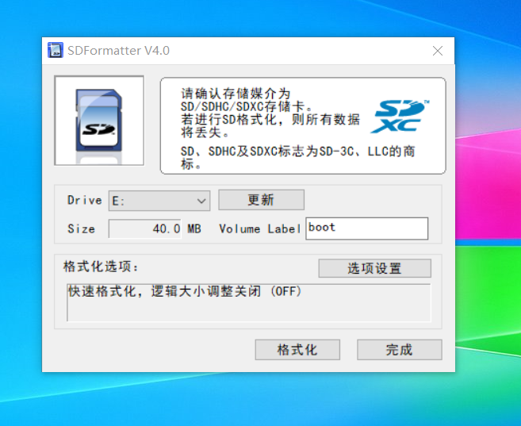

注意格式化前一定要选择逻辑分区大小调整，不然和没格式化没什么区别。其他选项就随便选。

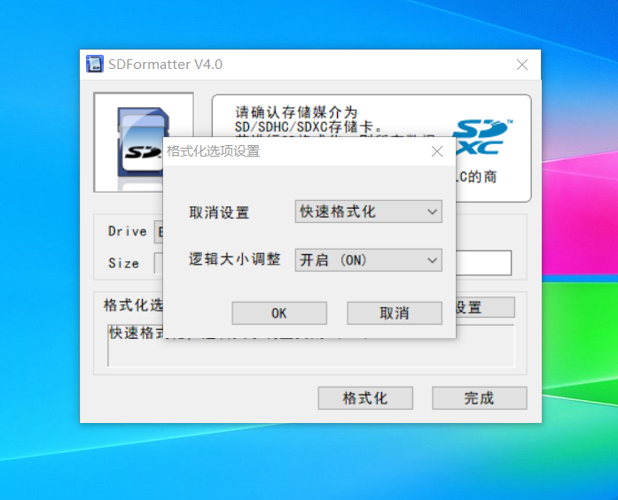

格式化完之后就用 *Win32DiskImager* 写入，直接导入.img的固件包然后点Write就可以了，不放心可以先检查一下MD5.
说到MD5，我就想起来之前有一次下载Ubuntu Server进行安装，结果不停地安装失败，提示下载的内容MD5不正确，折腾了好久才发现是安装包的MD5校验数据损坏了。

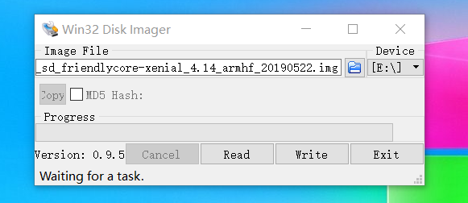

注意Win32DiskImager写入成功后Windows可能会有一堆弹窗，提示要格式化某某硬盘驱动器之类的，全部取消掉就可以了。这是因为Windows不能识别Win32DiskImager写入的ext4分区。

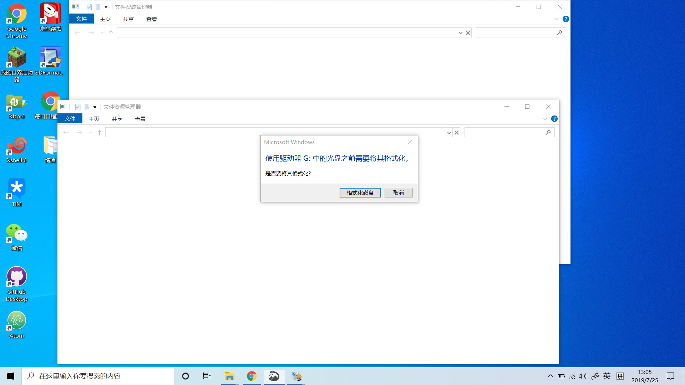

弹出存储卡，插入NanoPi NEO卡槽，接上网线，接通电源。等到板子上面的绿色灯亮，蓝色灯闪烁，网卡口灯闪烁，就说明系统启动成功了。随后可以SSH连接NanoPi NEO，默认用户有两个：

> 用户名：pi 密码：pi

> 用户名：root 密码：fa

建议使用root登录，以后不容易出错，并且强烈建议用命令 `passwd` 修改默认密码。

登陆进去后就可以用命令 `sudo npi-config` （root用户使用 `npi-config` ）进行初步配置，但是在此之前建议先执行命令

    sudo apt update

如果是root用户就是

    apt update

到这里为止，NanoPi NEO上手评测的第一步——装系统就结束了，至于如何折腾和评测，请继续关注我的博客。
